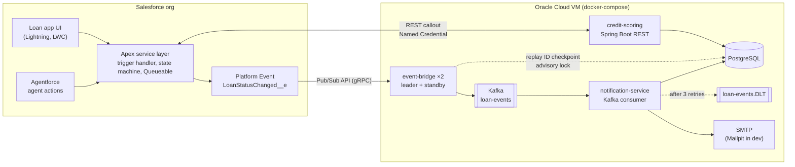
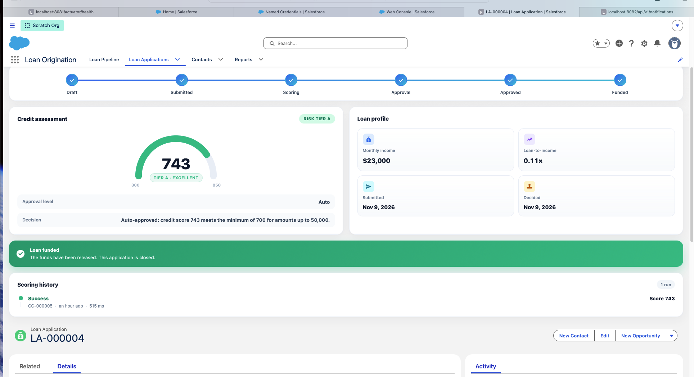
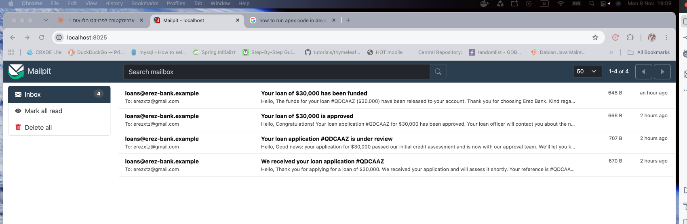
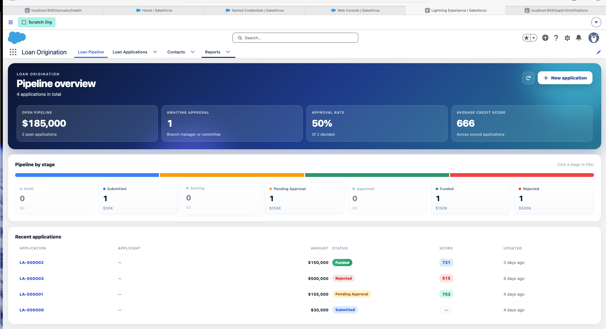
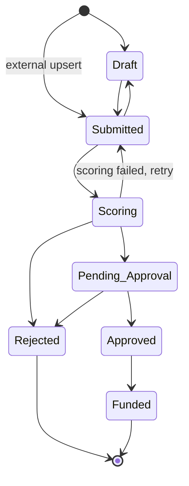

# Loan Origination: Salesforce + Spring Boot


A loan origination system for a bank, built on **Salesforce** as the system of record and integrated with external **Spring Boot** services through REST callouts and **event-driven messaging** (Platform Events → Kafka).

Loan officers create and manage applications in Salesforce. Each application moves through an enforced lifecycle, is scored by an external credit scoring service, is routed for approval based on configurable thresholds, and publishes every status change as an event for downstream systems.

---

## Architecture



**Main flow**

1. A loan officer creates a `Loan_Application__c`. The trigger handler enforces the status lifecycle and stamps lifecycle dates.
2. When the application moves to **Scoring**, a Queueable job calls the credit scoring service through a Named Credential. Every call is recorded as a `Credit_Check__c` audit record.
3. The score and risk tier are written back, and the application is routed by the thresholds in `Approval_Threshold__mdt`: auto-approval, branch manager, or credit committee.
4. Every status change publishes `LoanStatusChanged__e` (published after commit). The event bridge forwards it to Kafka, and the notification service emails the applicant at the steps they care about.

---

## End-to-end demo

A real run: loan LA-000004 (reference `#QDCAAZ` in the emails), $30,000, moves Draft → Submitted → Scoring → Approved → Funded.
The credit scoring service returns 743 (tier A) through the Named Credential callout, and the
amount and score fall within the auto-approval threshold. Each status change travels
Salesforce → Pub/Sub API → event bridge → Kafka → notification service, and the applicant gets
one email per customer-facing step (internal steps such as Scoring are recorded and skipped).





The home page of the app is a pipeline dashboard:



---

## Tech stack

| Area        | Technologies                                                                                                                                            |
| ----------- | ------------------------------------------------------------------------------------------------------------------------------------------------------- |
| Salesforce  | Apex (trigger handler, Queueable, callouts), Platform Events, Custom Metadata Types, Flow, Lightning App Builder, LWC, Agentforce, Permission Sets      |
| Integration | REST + Named / External Credentials, Salesforce Pub/Sub API (gRPC, Avro), OAuth 2.0 client credentials (External Client App), Apache Kafka (KRaft)      |
| Backend     | Java 21, Spring Boot 3.5, Spring Data JPA, Spring JDBC, Spring Kafka, Spring Mail, Bean Validation, Actuator                                            |
| Data        | PostgreSQL 17 (one database per service), Flyway migrations                                                                                             |
| Testing     | Apex tests with `System.runAs` and `HttpCalloutMock`, Jest for LWC, JUnit 5, MockMvc, `@DataJpaTest`, `@JdbcTest`, Embedded Kafka, H2 (PostgreSQL mode) |
| Tooling     | Salesforce CLI, SFDX source format, IntelliJ IDEA + Illuminated Cloud 2, Docker, docker-compose, Kafka UI, Mailpit, cloudflared, Git                    |
| Hosting     | Salesforce Developer Edition, Oracle Cloud Always Free VM                                                                                               |

---

## Repository layout

```
loan-origination/
├── force-app/main/default/        Salesforce metadata and Apex (SFDX source format)
│   ├── classes/                   Trigger handler, state machine, scoring job, approval router, controllers, tests
│   ├── lwc/                       Record page (command center, score gauge, status path) and pipeline dashboard
│   ├── triggers/                  One trigger per object, delegating to its handler
│   ├── objects/                   Custom objects, fields, validation rules, platform event, CMDT
│   ├── customMetadata/            Approval threshold records
│   ├── layouts/  tabs/            UI metadata
│   └── permissionsets/            Loan_Officer permission set
├── services/
│   ├── credit-scoring/            REST API Salesforce calls to score applications
│   ├── event-bridge/              Salesforce Pub/Sub API → Kafka, active/standby
│   ├── notification-service/      Kafka → applicant emails, dead-letter topic
│   ├── postgres/init/             Creates the scoring, notifications and bridge databases
│   └── docker-compose.yml         PostgreSQL, Kafka, Mailpit, Kafka UI and the three services
├── docs/images/                   Screenshots
├── config/                        Scratch org definition
├── manifest/package.xml           Metadata manifest
└── sfdx-project.json
```

---

## Salesforce data model

| Object                    | Type                                 | Purpose                                                                                                        |
| ------------------------- | ------------------------------------ | -------------------------------------------------------------------------------------------------------------- |
| `Contact`                 | Standard                             | The applicant                                                                                                  |
| `Loan_Application__c`     | Custom                               | The loan request: amount, term, income, purpose, status, score, risk tier, decision. Field history tracked.    |
| `Credit_Check__c`         | Custom, master-detail to application | Audit record of every scoring call: request id, score, status, response time, raw response                     |
| `Loan_Document__c`        | Custom, master-detail to application | Supporting documents (the files themselves are Salesforce Files). Roll-ups count total and verified documents. |
| `LoanStatusChanged__e`    | Platform Event                       | Published on every status change, after commit                                                                 |
| `Approval_Threshold__mdt` | Custom Metadata Type                 | Approval routing by maximum amount and minimum score, changeable without a deployment                          |

### Application lifecycle



Transitions are defined once in `LoanStatusMachine` and enforced in the trigger handler. Invalid transitions are rejected with a message that lists the allowed next statuses. Rejecting an application requires a decision reason.

---

## Credit scoring service

A Spring Boot REST service in [`services/credit-scoring`](services/credit-scoring):

- `POST /api/v1/credit-scores` returns a score from 300 to 850, a risk tier (A–D), the monthly payment, the debt-to-income ratio and the reasons for the score.
- `GET /api/v1/credit-scores?loanId=...` returns a loan's scoring history.
- Requests are authenticated with an API key that Salesforce supplies through an External Credential.
- Every decision is stored in PostgreSQL. A unique `request_id` makes retries **idempotent**, even across restarts and multiple instances.
- An optional failure simulation (`X-Simulate: error | slow`) demonstrates the Salesforce timeout and retry handling.

Details, the API contract and configuration are in the [service README](services/credit-scoring/README.md).

---

## Event bridge

[`services/event-bridge`](services/event-bridge) subscribes to `LoanStatusChanged__e` over the
**Salesforce Pub/Sub API** (gRPC) and publishes each event to the Kafka topic `loan-events`,
keyed by loan ID so all changes to one loan stay in order.

- Authenticates with the OAuth 2.0 client credentials flow of an External Client App; no user password or refresh token.
- Decodes Avro payloads; schemas are fetched once per schema ID and cached.
- **At-least-once delivery:** the replay ID is checkpointed only after Kafka acknowledged the event. A failed publish reopens the stream from the last checkpoint.
- **Checkpoint in PostgreSQL**, not on local disk, so it survives the loss of a container or a server.
- **Active/standby:** two instances compete for a PostgreSQL advisory lock. Only the holder subscribes; if it dies, the lock is released and the standby resumes from the shared checkpoint.

## Notification service

[`services/notification-service`](services/notification-service) consumes `loan-events` and emails
the applicant on Submitted, Pending_Approval, Approved, Rejected and Funded.

- **Idempotent consumer:** every event is stored by its `eventUuid`, so a redelivered event is never emailed twice.
- Every outcome is recorded as `SENT`, `SKIPPED` (internal status or no email) or `FAILED`, and exposed at `GET /api/v1/notifications`.
- Failures are retried 3 times, 2 seconds apart; messages that still fail, or can't be parsed, go to `loan-events.DLT` with the original bytes.

---

## Design decisions

- **One trigger per object, with all logic in a handler.** The trigger only passes `Trigger.new`, `Trigger.oldMap` and the operation type to the handler's constructor. The handler doesn't depend on the `Trigger` context and can be unit tested directly.
- **The state machine is kept separate from the trigger.** The same transition rules can be reused by the trigger, the Agentforce actions and future APIs.
- **Platform Events with `PublishAfterCommit`.** Subscribers only see committed changes, never ones that were rolled back. Salesforce doesn't know about Kafka; the bridge decouples them, and new consumers can be added without touching the org.
- **The callout runs in a Queueable, not in the trigger.** Apex doesn't allow callouts after DML in the same transaction, and asynchronous processing keeps saves fast.
- **Custom Metadata instead of hard-coded thresholds.** Business users can change approval limits without a deployment, and the values move between environments with the code.
- **Idempotency end to end.** Salesforce sends a request id with every scoring call, and the service stores decisions under a unique constraint, so a retry after a timeout never produces a second, different score.
- **Least privilege.** Field access is granted only through the `Loan_Officer` permission set. Tests run as a dedicated Standard User with that permission set, which proves the permission set is sufficient on its own.
- **At-least-once plus idempotent consumers, instead of exactly-once.** The bridge may deliver an event twice after a crash; the notification service drops duplicates by `eventUuid`. This is simpler and more robust than distributed transactions across Salesforce, Kafka and PostgreSQL.
- **Leader election with a PostgreSQL advisory lock.** The database is already there, the lock is released automatically when the leader's connection drops, and no ZooKeeper or Kubernetes lease is needed.
- **A dead-letter topic with an explicit name.** Poison messages never block a partition, keep their original bytes for investigation, and go to `loan-events.DLT` regardless of library defaults.
- **Flyway owns the schema.** Hibernate only validates the mapping (`ddl-auto: validate`), so drift between the code and the database stops the app at startup.

---

## Getting started

### Prerequisites

- [Salesforce CLI](https://developer.salesforce.com/tools/salesforcecli) and a free [Developer Edition org](https://developer.salesforce.com/signup)
- Java 21, Maven 3.9+, Docker

### Salesforce

```bash
sf org login web --alias myOrg
sf project deploy start --source-dir force-app --target-org myOrg
sf org assign permset --name Loan_Officer --target-org myOrg
sf apex run test --test-level RunLocalTests --code-coverage --result-format human --target-org myOrg --wait 30
```

Open the App Launcher and search for **Loan Applications**.

### Backend services

```bash
cd services
cp .env.example .env          # SCORING_API_KEY, DB_PASSWORD, SF_LOGIN_URL, SF_CLIENT_ID, SF_CLIENT_SECRET
docker compose up -d --build
docker compose ps             # all services healthy
```

Or start only the infrastructure (`docker compose up -d postgres kafka mailpit kafka-ui`) and run each
service from the IDE; their defaults point to `localhost`.

|                                 | URL                                                                          |
| ------------------------------- | ---------------------------------------------------------------------------- |
| Credit scoring                  | http://localhost:8080/actuator/health                                        |
| Event bridge (leader / standby) | http://localhost:8085/actuator/health, http://localhost:8086/actuator/health |
| Notification service            | http://localhost:8082/api/v1/notifications                                   |
| Kafka UI                        | http://localhost:8090                                                        |
| Mailpit                         | http://localhost:8025                                                        |

### Connecting Salesforce to the services

1. **Scoring callout:** expose credit scoring with `cloudflared tunnel --url http://localhost:8080` and set the tunnel URL on the `Credit_Scoring` Named Credential in Setup. Set the API key on the `Credit_Scoring` External Credential. Check with `System.debug(CreditScoringHealthCheck.check());` in Execute Anonymous.
2. **Event bridge:** create an External Client App with the client credentials flow and a Run As user, and put its consumer key and secret in `.env`. Details in the [event bridge README](services/event-bridge/README.md).

Then submit a loan that has an applicant email and follow it in Kafka UI and Mailpit.

---

## Testing

| Component                   | Tests                                                                                                                                                                                        | Coverage                |
| --------------------------- | -------------------------------------------------------------------------------------------------------------------------------------------------------------------------------------------- | ----------------------- |
| Apex                        | 7 test classes: transitions, field locking, rejection rules, scoring job with callout mocks, approval routing, controllers, health check, 200-record bulk update; run as a Loan Officer user | 96% org-wide            |
| LWC                         | 20 Jest tests: record page components and pipeline dashboard                                                                                                                                 | Jest                    |
| Credit scoring: engine      | Scoring rules, risk tier boundaries, amortization, determinism                                                                                                                               | JUnit 5                 |
| Credit scoring: API         | Authentication, validation (RFC 7807), idempotency, 409 on reused request id, history, simulated outage                                                                                      | MockMvc                 |
| Credit scoring: persistence | Flyway migration, JPA mapping, ordering, unique constraint                                                                                                                                   | `@DataJpaTest`          |
| Event bridge                | 23 tests: Avro decoding, checkpoint only after the Kafka ack, resume after restart, JDBC checkpoint store, leader election and failover, OAuth session                                       | JUnit 5, `@JdbcTest`    |
| Notification service        | 14 tests: templates, deduplication, skipped and failed sends, end-to-end consumption and dead-lettering on Embedded Kafka                                                                    | JUnit 5, Embedded Kafka |

---

## Roadmap

- [x] Salesforce data model, validation rules, layouts, permission set
- [x] Status state machine, trigger handler, platform event publisher, tests
- [x] Credit scoring service with PostgreSQL persistence
- [x] Named Credential and Queueable callout to the scoring service
- [x] Approval routing by `Approval_Threshold__mdt`
- [x] LWC record page and pipeline dashboard
- [x] Event bridge (Pub/Sub API → Kafka) and notification service
- [x] Bridge high availability: PostgreSQL checkpoint and leader election
- [ ] Agentforce action: "Why is this application stuck?"
- [ ] Deployment to Oracle Cloud with docker-compose
- [ ] CI with GitHub Actions (scratch org, Jest and Maven tests)
- [ ] Hebrew translation (Custom Labels, Translation Workbench, RTL)

---

## Author

**Erez Cohen** · Java backend and integration engineer · [GitHub](https://github.com/cohenerez)
