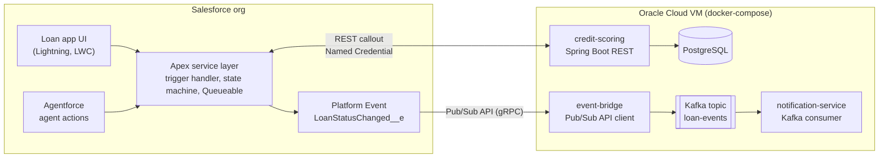
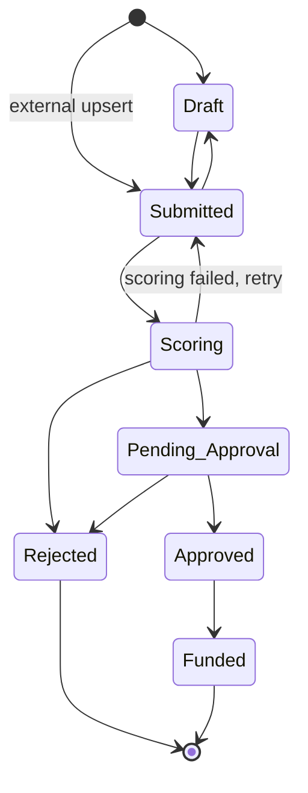

# Loan Origination: Salesforce + Spring Boot


A loan origination system for a bank, built on **Salesforce** as the system of record and integrated with external **Spring Boot** services through REST callouts and **event-driven messaging** (Platform Events → Kafka).

Loan officers create and manage applications in Salesforce. Each application moves through an enforced lifecycle, is scored by an external credit scoring service, is routed for approval based on configurable thresholds, and publishes every status change as an event for downstream systems.

---

## Architecture



**Main flow**

1. A loan officer creates a `Loan_Application__c`. The trigger handler enforces the status lifecycle and stamps lifecycle dates.
2. When the application moves to **Scoring**, a Queueable job calls the credit scoring service through a Named Credential. Every call is recorded as a `Credit_Check__c` audit record.
3. The score and risk tier are written back, and the application is routed by the thresholds in `Approval_Threshold__mdt`: auto-approval, branch manager, or credit committee.
4. Every status change publishes `LoanStatusChanged__e` (published after commit). The event bridge forwards it to Kafka, and the notification service informs the applicant.

---

## Tech stack

| Area | Technologies |
|---|---|
| Salesforce | Apex (trigger handler, Queueable, callouts), Platform Events, Custom Metadata Types, Flow, Lightning App Builder, LWC, Agentforce, Permission Sets |
| Integration | REST + Named / External Credentials, Salesforce Pub/Sub API (gRPC), Apache Kafka (KRaft) |
| Backend | Java 21, Spring Boot 3.5, Spring Data JPA, Bean Validation, Actuator |
| Data | PostgreSQL 17, Flyway migrations |
| Testing | Apex tests with `System.runAs` and `HttpCalloutMock`, JUnit 5, MockMvc, `@DataJpaTest`, H2 (PostgreSQL mode) |
| Tooling | Salesforce CLI, SFDX source format, IntelliJ IDEA + Illuminated Cloud 2, Docker, docker-compose, Git |
| Hosting | Salesforce Developer Edition, Oracle Cloud Always Free VM |

---

## Repository layout

```
loan-origination/
├── force-app/main/default/        Salesforce metadata and Apex (SFDX source format)
│   ├── classes/                   Trigger handler, state machine, event publisher, tests
│   ├── triggers/                  One trigger per object, delegating to its handler
│   ├── objects/                   Custom objects, fields, validation rules, platform event, CMDT
│   ├── customMetadata/            Approval threshold records
│   ├── layouts/  tabs/            UI metadata
│   └── permissionsets/            Loan_Officer permission set
├── services/
│   └── credit-scoring/            Spring Boot credit scoring service (see its README)
├── config/                        Scratch org definition
├── manifest/package.xml           Metadata manifest
└── sfdx-project.json
```

---

## Salesforce data model

| Object | Type | Purpose |
|---|---|---|
| `Contact` | Standard | The applicant |
| `Loan_Application__c` | Custom | The loan request: amount, term, income, purpose, status, score, risk tier, decision. Field history tracked. |
| `Credit_Check__c` | Custom, master-detail to application | Audit record of every scoring call: request id, score, status, response time, raw response |
| `Loan_Document__c` | Custom, master-detail to application | Supporting documents (the files themselves are Salesforce Files). Roll-ups count total and verified documents. |
| `LoanStatusChanged__e` | Platform Event | Published on every status change, after commit |
| `Approval_Threshold__mdt` | Custom Metadata Type | Approval routing by maximum amount and minimum score, changeable without a deployment |

### Application lifecycle



Transitions are defined once in `LoanStatusMachine` and enforced in the trigger handler. Invalid transitions are rejected with a message that lists the allowed next statuses. Rejecting an application requires a decision reason.

---

## Credit scoring service

A Spring Boot REST service in [`services/credit-scoring`](services/credit-scoring):

- `POST /api/v1/credit-scores` returns a score from 300 to 850, a risk tier (A–D), the monthly payment, the debt-to-income ratio and the reasons for the score.
- `GET /api/v1/credit-scores?loanId=...` returns a loan's scoring history.
- Requests are authenticated with an API key that Salesforce supplies through an External Credential.
- Every decision is stored in PostgreSQL. A unique `request_id` makes retries **idempotent**, even across restarts and multiple instances.
- An optional failure simulation (`X-Simulate: error | slow`) demonstrates the Salesforce timeout and retry handling.

Details, the API contract and configuration are in the [service README](services/credit-scoring/README.md).

---

## Design decisions

- **One trigger per object, with all logic in a handler.** The trigger only passes `Trigger.new`, `Trigger.oldMap` and the operation type to the handler's constructor. The handler doesn't depend on the `Trigger` context and can be unit tested directly.
- **The state machine is kept separate from the trigger.** The same transition rules can be reused by the trigger, the Agentforce actions and future APIs.
- **Platform Events with `PublishAfterCommit`.** Subscribers only see committed changes, never ones that were rolled back. Salesforce doesn't know about Kafka; the bridge decouples them, and new consumers can be added without touching the org.
- **The callout runs in a Queueable, not in the trigger.** Apex doesn't allow callouts after DML in the same transaction, and asynchronous processing keeps saves fast.
- **Custom Metadata instead of hard-coded thresholds.** Business users can change approval limits without a deployment, and the values move between environments with the code.
- **Idempotency end to end.** Salesforce sends a request id with every scoring call, and the service stores decisions under a unique constraint, so a retry after a timeout never produces a second, different score.
- **Least privilege.** Field access is granted only through the `Loan_Officer` permission set. Tests run as a dedicated Standard User with that permission set, which proves the permission set is sufficient on its own.
- **Flyway owns the schema.** Hibernate only validates the mapping (`ddl-auto: validate`), so drift between the code and the database stops the app at startup.

---

## Getting started

### Prerequisites

- [Salesforce CLI](https://developer.salesforce.com/tools/salesforcecli) and a free [Developer Edition org](https://developer.salesforce.com/signup)
- Java 21, Maven 3.9+, Docker

### Salesforce

```bash
sf org login web --alias myOrg
sf project deploy start --source-dir force-app --target-org myOrg
sf org assign permset --name Loan_Officer --target-org myOrg
sf apex run test --test-level RunLocalTests --code-coverage --result-format human --target-org myOrg --wait 30
```

Open the App Launcher and search for **Loan Applications**.

### Credit scoring service

```bash
cd services/credit-scoring
echo "SCORING_API_KEY=dev-key" > .env
docker compose up -d postgres
mvn test
SCORING_API_KEY=dev-key mvn spring-boot:run
```

```bash
curl -s -X POST localhost:8080/api/v1/credit-scores \
  -H 'X-API-Key: dev-key' -H 'Content-Type: application/json' \
  -d '{"requestId":"r1","loanId":"a0X1","amount":100000,"termMonths":60,"monthlyIncome":15000,"purpose":"Personal"}'
```

---

## Testing

| Component | Tests | Coverage |
|---|---|---|
| Apex: trigger, handler, state machine, event publisher | 10 tests: valid and blocked transitions, rejection rules, full path to Funded, 200-record bulk update, bypass | 96% org-wide |
| Credit scoring: engine | Scoring rules, risk tier boundaries, amortization, determinism | JUnit 5 |
| Credit scoring: API | Authentication, validation (RFC 7807), idempotency, 409 on reused request id, history, simulated outage | MockMvc |
| Credit scoring: persistence | Flyway migration, JPA mapping, ordering, unique constraint | `@DataJpaTest` |

---

## Roadmap

- [x] Salesforce data model, validation rules, layouts, permission set
- [x] Status state machine, trigger handler, platform event publisher, tests
- [x] Credit scoring service with PostgreSQL persistence
- [ ] Named Credential and Queueable callout to the scoring service
- [ ] Approval routing by `Approval_Threshold__mdt`
- [ ] LWC application screen
- [ ] Event bridge (Pub/Sub API → Kafka) and notification service
- [ ] Agentforce action: "Why is this application stuck?"
- [ ] Deployment to Oracle Cloud with docker-compose
- [ ] CI with GitHub Actions (scratch org and Maven tests)

---

## Author

**Erez Cohen** · Java backend and integration engineer · [GitHub](https://github.com/cohenerez)
