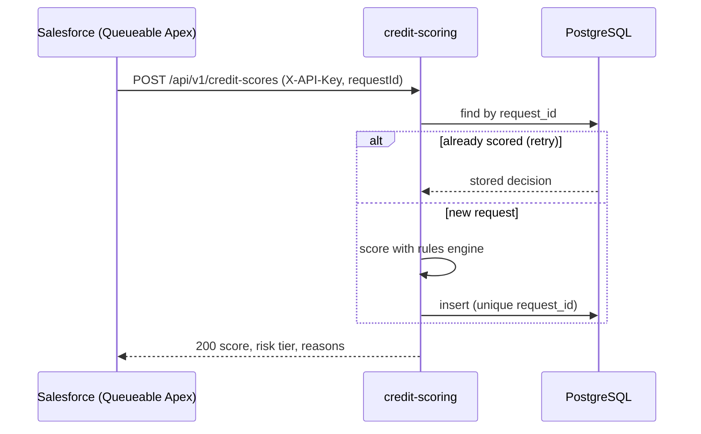

# credit-scoring


A Spring Boot REST service that scores loan applications for the [Salesforce loan origination app](../../README.md).
Salesforce calls it from a Queueable Apex job through a Named Credential, stores the result on the
application, and routes the application for approval based on the risk tier.



---

## API

### Score a loan

`POST /api/v1/credit-scores` with the header `X-API-Key: <key>`

```json
{
  "requestId": "6f1c2e7a-0b7e-4c1d-9a51-3f0a8c2d1e44",
  "loanId": "a0X1",
  "amount": 100000,
  "termMonths": 60,
  "monthlyIncome": 15000,
  "purpose": "Personal"
}
```

| Field | Rules |
|---|---|
| `requestId` | Required, up to 64 characters. Idempotency key generated by Salesforce. |
| `loanId` | Required, up to 18 characters (Salesforce record Id). |
| `amount` | Required, greater than 0. |
| `termMonths` | Required, 6 to 360. |
| `monthlyIncome` | Required, greater than 0. |
| `purpose` | Optional: `Mortgage`, `Auto`, `Personal` or `Business`. |

Response:

```json
{
  "requestId": "6f1c2e7a-0b7e-4c1d-9a51-3f0a8c2d1e44",
  "loanId": "a0X1",
  "score": 737,
  "riskTier": "B",
  "monthlyPayment": 1933.28,
  "debtToIncome": 0.1289,
  "reasons": ["Low payment-to-income ratio"],
  "modelVersion": "rules-v1",
  "scoredAt": "2026-11-05T09:15:30.123456Z"
}
```

| Status | Meaning |
|---|---|
| 200 | Scored. A retry with the same `requestId` returns the stored decision (idempotent). |
| 400 | Invalid body, returned as RFC 7807 problem details. |
| 401 | Missing or wrong `X-API-Key`. |
| 409 | The `requestId` was already used for a different loan. |
| 503 | Service unavailable. Salesforce should retry with the same `requestId`. |

### Scoring history

`GET /api/v1/credit-scores?loanId=<id>` returns every decision for a loan, newest first.

### Health

`GET /actuator/health` returns the service and database status. It doesn't require the API key, so hosting platforms can use it for health checks.

---

## Scoring model

A deterministic rules engine (`rules-v1`): the same loan always gets the same score, which keeps demos
repeatable and tests stable. It's a demo model, not a real credit model.

| Factor | Effect |
|---|---|
| Base score | 700 |
| Monthly payment ÷ monthly income (payment at a fixed 6% annual rate) | ≤ 20%: +60 · ≤ 30%: +30 · ≤ 40%: 0 · ≤ 50%: −60 · above 50%: −140 |
| Loan amount ÷ annual income | above 5×: −40 · above 3×: −15 |
| Term above 240 months | −10 |
| Purpose | Mortgage +15 · Auto +5 · Personal −10 · Business −20 |
| Per-loan variation | −25 to +25, derived from the loan Id |

The score is clamped to 300–850. Risk tiers: **A** ≥ 740, **B** ≥ 680, **C** ≥ 620, **D** below 620.

---

## Persistence

- **PostgreSQL**, with the schema managed by **Flyway** (`src/main/resources/db/migration`).
- Hibernate runs with `ddl-auto: validate`, so the app refuses to start if the entity mapping and the schema disagree.
- Every decision is stored in the `credit_score` table as an audit trail.
- The unique `request_id` column is the idempotency key. Retries are safe across restarts and multiple instances. If two retries arrive at the same moment, the constraint lets only one insert succeed, and the other request returns that stored decision.

| Column | Type | Notes |
|---|---|---|
| `id` | UUID | Primary key |
| `request_id` | VARCHAR(64) | Unique |
| `loan_id` | VARCHAR(18) | Indexed with `scored_at` |
| `amount`, `monthly_income`, `monthly_payment` | NUMERIC(16,2) | |
| `term_months`, `score` | INTEGER | Score checked to be 300–850 |
| `risk_tier` | VARCHAR(1) | Checked to be A–D |
| `debt_to_income` | NUMERIC(12,4) | |
| `purpose`, `reasons`, `model_version` | VARCHAR | Reasons stored newline-separated |
| `scored_at` | TIMESTAMP WITH TIME ZONE | |

---

## Project structure

```
src/main/java/com/erez/loans/scoring/
├── api/            REST controller, request/response records, service (idempotency, mapping)
├── engine/         Scoring rules: pure Java, no Spring or HTTP dependencies
├── persistence/    JPA entity, repository, reasons converter
├── security/       API key filter (constant-time comparison)
└── config/         Typed configuration properties, Clock bean
src/main/resources/
├── application.yml
└── db/migration/   Flyway migrations
```

---

## Running locally

Prerequisites: Java 21, Maven 3.9+, Docker.

```bash
echo "SCORING_API_KEY=dev-key" > .env          # read by docker compose; never committed
docker compose up -d postgres
SCORING_API_KEY=dev-key mvn spring-boot:run
```

In IntelliJ, add `SCORING_API_KEY=dev-key` to the run configuration's environment variables.

Try it:

```bash
curl -s localhost:8080/actuator/health

curl -s -X POST localhost:8080/api/v1/credit-scores \
  -H 'X-API-Key: dev-key' -H 'Content-Type: application/json' \
  -d '{"requestId":"r1","loanId":"a0X1","amount":100000,"termMonths":60,"monthlyIncome":15000,"purpose":"Personal"}'

curl -s 'localhost:8080/api/v1/credit-scores?loanId=a0X1' -H 'X-API-Key: dev-key'
```

Inspect the database:

```bash
docker compose exec postgres psql -U scoring -d scoring \
  -c "SELECT request_id, loan_id, score, risk_tier, scored_at FROM credit_score;"
```

Run the database and the service together in containers:

```bash
docker compose up --build
```

---

## Configuration

| Variable | Default | Purpose |
|---|---|---|
| `SCORING_API_KEY` | none (required) | Shared secret expected in `X-API-Key`. The app refuses to start without it. |
| `DB_URL` | `jdbc:postgresql://localhost:5432/scoring` | JDBC URL |
| `DB_USERNAME` / `DB_PASSWORD` | `scoring` / `scoring` | Database credentials (local development only) |
| `SCORING_SIMULATION_ENABLED` | `false` | Enables the `X-Simulate` header |
| `PORT` | `8080` | HTTP port |

### Failure simulation

With `SCORING_SIMULATION_ENABLED=true`, the header `X-Simulate: error` returns 503, and `X-Simulate: slow`
waits 15 seconds. Use it to demonstrate the Salesforce timeout and retry handling. Keep it off in any shared environment.

---

## Testing

```bash
mvn test
```

Tests run on H2 in PostgreSQL mode with the same Flyway migration, so they don't need Docker.

| Test class | Covers |
|---|---|
| `ScoringEngineTest` | Strong and weak applicants, determinism, score range, amortization (100,000 over 60 months = 1,933.28), tier boundaries |
| `CreditScoreControllerTest` | Valid request, missing and wrong API key, validation errors, idempotent retry, 409 on reused `requestId`, history order, simulated 503, open health endpoint |
| `CreditScoreRepositoryTest` | Migration and mapping, reasons round-trip, newest-first ordering, unique `request_id` |

---

## Design notes

- **The engine knows nothing about HTTP or the database.** It takes `LoanFacts` and returns a `ScoringResult`, so it could be replaced by a real model without changing the API.
- **Idempotency lives in the database, not in memory.** A unique constraint is the only approach that stays correct across restarts, concurrent retries and multiple instances.
- **Fail fast on configuration.** A missing API key or a schema mismatch stops startup instead of running an unprotected or broken service.
- **Errors use standard problem details** (RFC 7807), so clients get a consistent error format.
- **The container runs as a non-root user**, and the image is built in two stages, so the build tools stay out of the runtime image.
