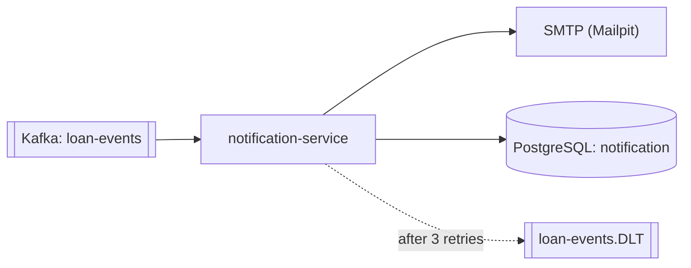

# notification-service

Consumes loan events from the Kafka topic `loan-events` and emails the applicant at the steps
they care about. In development, emails go to **Mailpit** (inbox at http://localhost:8025).



## Behaviour

| New status       | Email                                                                                        |
| ---------------- | -------------------------------------------------------------------------------------------- |
| Submitted        | "We received your loan application"                                                          |
| Pending_Approval | "Your loan application is under review"                                                      |
| Approved         | "Your loan of $X is approved"                                                                |
| Rejected         | "An update on your loan application": no internal reason or score, the loan officer explains |
| Funded           | "Your loan of $X has been funded"                                                            |
| Draft, Scoring   | None (internal steps)                                                                        |

- **Idempotent:** every event is stored by its `eventUuid` (unique). A repeat of a handled event sends nothing,
  so the at-least-once delivery of the bridge and Kafka never produces duplicate emails.
- **Retries:** a failed send is recorded as `FAILED` and retried three times, two seconds apart. After that
  the event goes to `loan-events.DLT`.
- **Malformed messages** go straight to the DLT, without retries.
- **Applications without an email** are recorded as `SKIPPED`.

`GET /api/v1/notifications?loanId=<id>` lists what was sent for a loan (or the latest 50 without `loanId`).

## Run

```bash
docker compose up -d postgres kafka mailpit     # from services/
mvn spring-boot:run
```

## Tests

`mvn test`. They run on H2 (PostgreSQL mode) and an embedded Kafka broker, so no Docker is needed.

| Test                               | Covers                                                                                            |
| ---------------------------------- | ------------------------------------------------------------------------------------------------- |
| `LoanEventListenerIntegrationTest` | JSON on the topic → email sent and stored; a malformed message lands on the DLT                   |
| `NotificationServiceTest`          | Send and record, duplicate events, skipped statuses, missing email, failure then successful retry |
| `NotificationTemplatesTest`        | A template for each customer-facing status, no leaks in rejections, amount formatting             |
